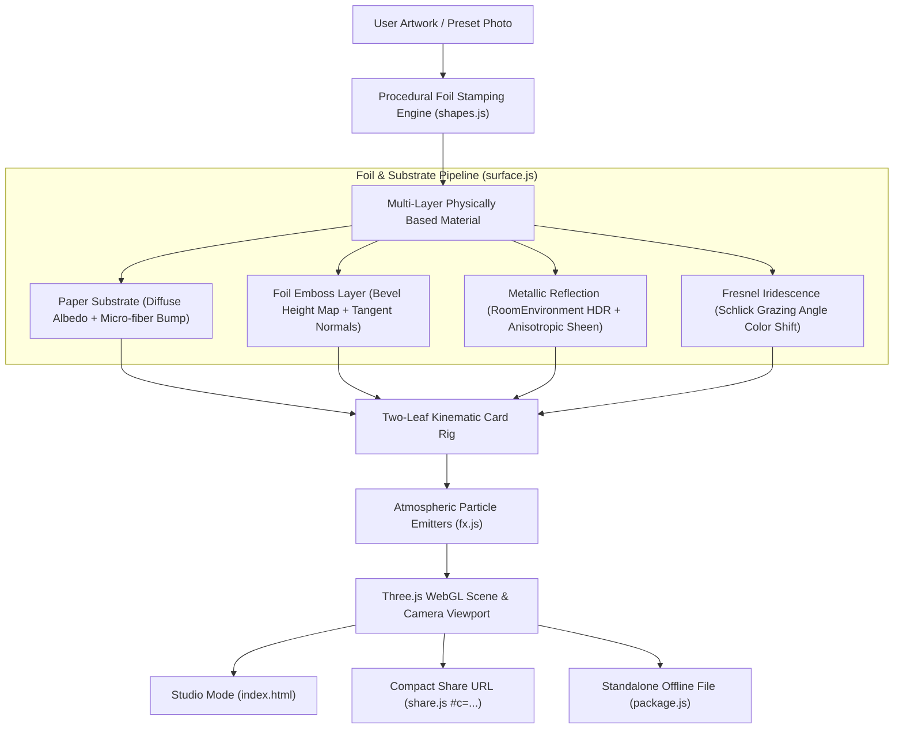

<div align="center">


# GlimmerFold

<p><b>Turn any picture into an interactive, 3D foil-embossed greeting card that opens, catches light, and comes alive.</b></p>

<p>
  <a href="LICENSE"></a>
  <a href="https://github.com/Mxhi-04/GlimmerFold/actions/workflows/ci.yml"></a>
  <a href="https://threejs.org/"></a>
  <a href="https://developer.mozilla.org/en-US/docs/Web/API/WebGL_API"></a>
  
  
</p>

<p>
  <a href="#-quick-start"><b>Quick Start</b></a> ·
  <a href="#-the-experience"><b>Experience</b></a> ·
  <a href="#-interactive-controls"><b>Controls</b></a> ·
  <a href="#-architecture--shading-pipeline"><b>Architecture</b></a> ·
  <a href="#-standalone-offline-bundler"><b>Offline Bundler</b></a> ·
  <a href="CONTRIBUTING.md"><b>Contributing</b></a>
</p>

</div>

---

## ✨ The Experience

Traditional digital greeting cards are static flat images or looped videos. **GlimmerFold** treats greeting cards as physical craft objects using real-time WebGL physical rendering:

- 🌟 **Multi-Spectrum Foil Reflections**: Anisotropic specular highlights with micro-embossing depth and iridescent color-shifts across **Gold, Rose Gold, Holographic Rainbow, Brushed Silver, Metallic Emerald,** and **Antique Copper**.
- 📖 **Physically-Grounded Kinematics**: Two-leaf hinge dynamics with natural angular damping. Drag to tilt and catch light highlights; tap to realistically open the cover and reveal the greeting message.
- 🎨 **Artisan Paper Textures**: Realistic tactile paper substrates including **Textured Linen, Recycled Cotton Rag, Silk Ivory, Matte Kraft,** and **Fine Vellum**.
- 🪄 **Living Celebratory Ambiance**: Atmospheric particles and celebratory effects — bursting confetti ribbons, sparkling stardust, floating flower petals, and soft ambient light glows.
- 📦 **Offline Single-File Bundler**: One-click download compiles the entire card, 3D WebGL engine, custom shaders, and photos into a single self-contained `.html` file that runs anywhere, even offline.
- 🔗 **Zero-Backend Link Sharing**: Instant share links encode the entire layout, message typography, and foil settings directly into URL hashes without database storage or accounts.

---

## 🎮 Interactive Controls

| Gesture / Input | Action | Effect |
| :--- | :--- | :--- |
| **Tap / Click** | Toggle Card | Unfolds or closes the card with smooth physical spring damping |
| **Drag / Touch-move** | 3D Orbit & Tilt | Rotates the card across XYZ axes to view glancing foil specular reflections |
| **Pinch / Wheel** | Dynamic Zoom | Inspects micro-embossed paper grain, foil edge-bevels, and typography |
| **Play Button (▶)** | Cinematic Tour | Starts an automated slow tilt-and-open inspection sequence |
| **Drop Image** | Instant Cardify | Drag & drop any photo or drawing onto the card stage to create custom foil art |

---

## 🚀 Quick Start

Run GlimmerFold locally in less than 30 seconds without npm build chains or complex setup:

```bash
# 1. Clone the repository
git clone https://github.com/Mxhi-04/GlimmerFold.git
cd GlimmerFold

# 2. Launch the dev server (Python 3.8+ built-in)
python3 serve.py 5173

# Or using npm
npm run dev
```

Visit [`http://localhost:5173`](http://localhost:5173) in your browser.

<details>
<summary><b>📦 NPM Scripts Overview</b></summary>

```bash
npm run dev          # Start local threaded HTTP server
npm run test:syntax  # Validate ES module syntax across all js/*.js files
```

</details>

---

## 🧠 Architecture & Shading Pipeline



### Module Breakdown

| Module | Responsibility |
| :--- | :--- |
| [`js/main.js`](js/main.js) | Application state coordinator, pointer events, UI deck binding, render loop |
| [`js/surface.js`](js/surface.js) | Three.js geometry, folding hinge kinematics, procedural foil shaders & PBR |
| [`js/package.js`](js/package.js) | Standalone single-file compiler embedding modules & assets into offline `.html` |
| [`js/presets.js`](js/presets.js) | Curated card collection, colorways, typography pairings, and foil profiles |
| [`js/fx.js`](js/fx.js) | Particle physics, celebratory confetti bursts, sparkles, and petal drift |
| [`js/shapes.js`](js/shapes.js) | Procedural foil stamp generation and alpha-channel vector masking |
| [`js/share.js`](js/share.js) | Compact LZW state compression and decompression for `#c=...` links |
| [`js/life.js`](js/life.js) | Ambient lighting transitions, subtle motion breathing, and idle shimmer |
| [`brand.html`](brand.html) | Brand identity showcase, typography tokens, vector lockups, and design system |

---

## 📦 Standalone Offline Bundler

One of GlimmerFold's most powerful capabilities is **Zero-Dependency Card Export**:

```
[Card Design in Studio] ──▶ Click "The card itself" ──▶ glimmerfold-card.html (~2 MB)
```

1. Select **Download the card** → **The card itself**.
2. GlimmerFold packages the Three.js runtime, lighting maps, shaders, fonts, personal greeting, and foil data into **one standalone `.html` file**.
3. Send this file via email, AirDrop, or messaging app:
   - Opens by double-clicking in **any browser** on Mac, Windows, Linux, iOS, or Android.
   - **100% offline functional**: No server, no external API, and no link decay.

---

## 🌐 Browser Compatibility

| Browser | Platform | Compatibility | Capabilities |
| :--- | :--- | :---: | :--- |
| **Google Chrome / Chromium** | macOS, Windows, Linux, Android | ✅ Full | WebGL2, PBR Shaders, Touch Kinematics, Offline Bundling |
| **Apple Safari** | macOS, iOS, iPadOS | ✅ Full | WebGL, Retina HiDPI, Gyro & Pointer Events, Standalone HTML |
| **Mozilla Firefox** | macOS, Windows, Linux, Android | ✅ Full | WebGL2, Anisotropic Filtering, Smooth Damped Orbit |
| **Microsoft Edge** | macOS, Windows | ✅ Full | Hardware-accelerated Canvas, RoomEnvironment Reflection |

---

## 🗺️ Project Roadmap

- [x] Three.js WebGL card stage with realistic fold kinematics
- [x] Multi-tint foil shaders (Gold, Rose Gold, Silver, Holographic, Emerald, Copper)
- [x] Ambient particle effects (confetti, sparkles, floating petals)
- [x] URL hash state sharing (`#c=...`)
- [x] Standalone offline `.html` card exporter
- [x] Automated CI module syntax checks
- [ ] Device gyroscope tilt support on mobile iOS & Android
- [ ] Envelope unboxing animation sequence before card reveal
- [ ] Custom sound design: paper rustle and tactile foil snap

---

## 🤝 Contributing

Contributions are welcome! Please check out [CONTRIBUTING.md](CONTRIBUTING.md) for local dev guidelines, presets structure, and shader tips.

1. Fork the repository
2. Create your feature branch (`git checkout -b feature/gorgeous-foil`)
3. Commit your changes (`git commit -m 'feat: add iridescent opal foil preset'`)
4. Push to the branch (`git push origin feature/gorgeous-foil`)
5. Open a Pull Request

---

## 📄 License

GlimmerFold is open-source under the [MIT License](LICENSE).

<div align="center">

<sub>Crafted with passion for physical papercraft & modern WebGL.</sub><br>
<sub>If you love GlimmerFold, give the repository a ⭐! · <a href="#glimmerfold">Back to top ↑</a></sub>

</div>
